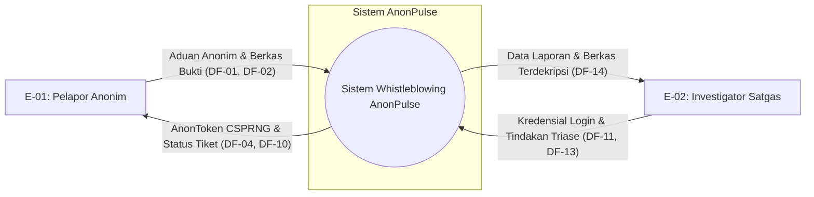

# Data Flow Diagram (DFD) & Batas Kepercayaan - AnonPulse

**Versi:** 0.1 (Milestone sec-0.1)  
**Mata Kuliah:** Keamanan Komputasi dan Siber (KKS)  
**Institusi:** Universitas Pertamina

---

## 1. Kamus Elemen Sistem (DFD Entities Dictionary)

Untuk menghindari ancaman generik, seluruh komponen sistem AnonPulse diberi identifikasi unik:

### A. Entitas Eksternal (External Entities)

- **`E-01` Pelapor Anonim:** Pengguna publik (mahasiswa, dosen, tendik) yang mengirimkan aduan kekerasan/pelanggaran atau memantau status kasus melalui peramban web.
- **`E-02` Investigator Satgas:** Anggota tim Satgas Pencegahan dan Penanganan Kekerasan Seksual/Etik yang berwenang menelaah, mengubah status, dan menginvestigasi aduan melalui portal terautentikasi.

### B. Proses Sistem (Processes)

- **`P-01` Sanitasi Sisi Klien & Form Handler:** Modul React/TypeScript di peramban yang memvalidasi masukan form, memicu _Panic Button_, dan menghapus metadata EXIF gambar secara lokal.
- **`P-02` Reverse Proxy & TLS Ingress:** Lapisan Nginx/Ingress yang menerima lalu lintas web publik, menegakkan HTTPS/TLS, serta menerapkan sanitasi dan penyamaran (_masking_) alamat IP/header pelapor.
- **`P-03` Backend API Controller & Router:** Layanan API yang memproses rute pengiriman tiket, verifikasi payload, dan kueri pelacakan tiket.
- **`P-04` Modul Kriptografi & Token Engine:** Layanan internal yang mengeksekusi pembangkitan AnonToken via CSPRNG (`token_gen.py`) dan pembuatan digest integritas SHA-256 (`hasher.py`).
- **`P-05` Portal Investigasi & Kontrol Akses (RBAC):** Modul otentikasi multi-faktor dan otorisasi berbasis peran untuk staf Satgas.

### C. Penyimpanan Data (Data Stores)

- **`DS-01` Basis Data Kasus (Case DB):** Basis data relasional internal yang menyimpan data rekaman tiket, relasi status, narasi kronologi, dan hash pencocokan AnonToken.
- **`DS-02` Vault Berkas Bukti (Evidence File Storage):** Penyimpanan volume privat terenkripsi khusus dokumen/lampiran bukti digital kasus.
- **`DS-03` Audit Trail Store:** Log sistem persisten _append-only_ yang mencatat waktu akses, pembacaan, dan mutasi status oleh investigator.
- **`DS-04` Memori Klien (Local State):** State sementara pada memori React dan session peramban pelapor (dibersihkan saat tombol panik ditekan).

### D. Aliran Data (Data Flows)

- **`DF-01`:** Payload form aduan awal dan file mentah.
- **`DF-02`:** Berkas tersanitasi (bebas EXIF) dan data aduan siap kirim.
- **`DF-03`:** Panggilan pembuatan token acak berentropi tinggi.
- **`DF-04`:** Penyerahan AnonToken hasil CSPRNG (`AP-XXXX-XXXX-XXXX`).
- **`DF-05`:** Payload berkas lampiran untuk hashing.
- **`DF-06`:** Nilai hash SHA-256 berkas bukti (digest 64 karakter hex).
- **`DF-07`:** Persistensi data aduan, relasi status, dan hash token.
- **`DF-08`:** Penyimpanan berkas lampiran bukti digital terverifikasi.
- **`DF-09`:** Kueri pelacakan status dengan AnonToken.
- **`DF-10`:** Data status penanganan kasus ke pelapor.
- **`DF-11`:** Kredensial login Satgas + token MFA.
- **`DF-12`:** Sesi valid dan hak akses investigasi.
- **`DF-13`:** Permintaan data kasus dan pembaruan triase.
- **`DF-14`:** Narasi kasus dan tautan berkas bukti terdekripsi.
- **`DF-15`:** Pencatatan peristiwa investigasi (_tamper-evident audit log_).

---

## 2. Definisi Batas Kepercayaan (Trust Boundaries)

Sistem AnonPulse memiliki 2 (dua) batas kepercayaan utama:

- **`TB-01` (Batas Peramban Klien - Internet Publik):** Memisahkan lingkungan eksekusi peramban pengguna yang tidak tepercaya (_untrusted client environment_) dengan infrastruktur server kampus melalui jaringan publik internet. Setiap data yang melintasi TB-01 rentan terhadap intersepsi jaringan, kebocoran metadata IP, dan serangan manipulasi parameter.
- **`TB-02` (Batas Jaringan Server - Database Internal):** Memisahkan lingkungan _Application Server/DMZ_ yang dapat diakses via API dengan subnet internal terisolasi tempat _Data Stores_ (`DS-01`, `DS-02`, `DS-03`) berada. Komunikasi melintasi TB-02 hanya diizinkan melalui jalur privat dengan enkripsi saluran internal dan kontrol akses berbasis _least-privilege_.

---

## 3. Data Flow Diagram Level 0 (Context Diagram)

Diagram konteks memperlihatkan interaksi global antara entitas eksternal dengan batas sistem AnonPulse:

